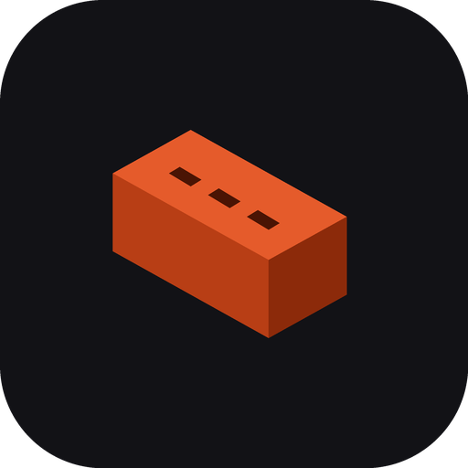

<p align="center">
  
</p>

<h1 align="center">Brik</h1>

<p align="center">
  <strong>Privileged Android Digital Enforcement & Immutable Focus</strong>
</p>

<p align="center">
  <a href="https://github.com/Hotaro26/brik/releases"></a>
  
  
  
  <a href="LICENSE"></a>
</p>

<p align="center">
  <a href="#philosophy--motivation">Philosophy</a> &bull;
  <a href="#privileged-architecture">Architecture</a> &bull;
  <a href="#core-capabilities">Capabilities</a> &bull;
  <a href="#screenshots">Screenshots</a> &bull;
  <a href="#setup--installation">Setup Guide</a> &bull;
  <a href="#workflow">Workflow</a> &bull;
  <a href="#technical-specifications">Specifications</a>
</p>

---

**Brik** is a privileged Android digital enforcement and focus application engineered to eliminate compulsive digital distractions through *immutable commitment*. 

Rather than relying on easily bypassable timers, accessibility services, or overlay permissions, Brik interfaces directly with Android platform management APIs&mdash;including **Device Policy Manager** (*Device Owner*), **Dhizuku**, **Shizuku**, and **Root**&mdash;to enforce operating-system-level package suspension, app concealment, and uninstallation protection.

---

## Philosophy & Motivation

Most mobile screen-time blockers fail because they rely on *self-regulation* at the exact moment when self-regulation is at its weakest. Accessibility-based blockers can be toggled off in two taps, overlays can be swiped away, and standard applications can simply be uninstalled when an impulsive urge strikes.

> [!IMPORTANT]
> **Brik is built on the principle of immutable friction.**
> True focus in an attention-economy environment requires *absolute, physical resistance*. By locking applications through Android enterprise management APIs, boundaries become strictly non-negotiable. Once an application bag is sealed with a secret passphrase, a randomized physical QR token, or an external barcode, the friction required to reverse the decision forces intentionality and disrupts dopamine-driven feedback loops.

---

## Screenshots

<div align="center">
  <table>
    <tr>
      <td align="center"><br /><sub><b></b></sub></td>
      <td align="center"><br /><sub><b></b></sub></td>
      <td align="center"><br /><sub><b></b></sub></td>
    </tr>
    <tr>
      <td align="center"><br /><sub><b></b></sub></td>
      <td align="center"><br /><sub><b></b></sub></td>
      <td align="center"><br /><sub><b></b></sub></td>
    </tr>
    <tr>
      <td align="center"><br /><sub><b></b></sub></td>
      <td align="center"><br /><sub><b></b></sub></td>
      <td align="center"><br /><sub><b></b></sub></td>
    </tr>
  </table>
</div>

---

## Privileged Architecture

Brik operates across a **four-tier privilege hierarchy**, automatically detecting and leveraging the highest capability bridge available while gracefully degrading based on your device configuration:

| Tier | Bridge | Mechanism | Key Capabilities | Best For |
| :---: | :--- | :--- | :--- | :--- |
| **1** | **Device Owner** (`DPM`) | Native Android Enterprise API | &bull; Kernel-level package suspension<br />&bull; Anti-tamper uninstallation lockout<br />&bull; Single-app Kiosk mode | Maximum enforcement without root |
| **2** | **Dhizuku Bridge** | Delegated Device Owner IPC | &bull; Full enterprise policy enforcement<br />&bull; Package freezing & hiding | Users already utilizing Dhizuku |
| **3** | **Shizuku Bridge** | User-space ADB Permission IPC | &bull; Package suspension & launcher hiding<br />&bull; No computer needed after initial setup | Non-root users seeking quick setup |
| **4** | **Root Shell** (`libsu`) | Direct privileged shell (`su`) | &bull; Direct system package management<br />&bull; Unrestricted execution | Rooted devices (Magisk / KernelSU / APatch) |

---

## Core Capabilities

### 1. App Bags & Targeted Grouping
* **Custom Application Bundles**: Create purpose-driven groupings such as *Social Media*, *Shorts/Reels*, *Games*, or *Work Hours*.
* **High-Speed Package Scanner**: Rapidly scan and search all installed third-party and system applications.
* **Independent Bag States**: Lock or unlock specific bundles independently based on context.

### 2. Flexible Commitment Mechanisms
* **Alphanumeric Password**: Protect bags with a secret passphrase (self-imposed or entrusted to an accountability partner).
* **Random Cryptographic QR Token**: Generates a unique UUID token rendered as a QR code. Save the QR code onto a physical card, store it on a remote workstation, or print it out to establish deliberate physical friction.
* **External Physical Object Pairing**: Pair an app bag with *any real-world barcode or QR code* (e.g., an ISBN barcode on a book in another room). The bag cannot be unlocked without physically walking over and scanning that designated object.

> [!TIP]
> **Physical Friction via Real-World QR Pairing:** Pair an app bag with a physical barcode on an item located in another room (e.g., an ISBN barcode on a book or an appliance in the kitchen). This breaks impulsive unlocking habits by requiring you to physically stand up and walk to the object to regain access.

### 3. Policy Enforcement Engines
* **OS-Level Package Suspension**: Freezes applications at the Android OS layer. Suspended applications are grayed out by the launcher and cannot be launched by the user or background tasks.
* **App Concealment (*Launcher Invisibility*)**: Unregisters launcher activities, causing distracting apps to completely vanish from the home screen and app drawer.
* **Single-App Kiosk Mode**: Locks the device into a designated productive application, disabling home navigation, recent apps, and status bar expansion.
* **Anti-Tamper Uninstallation Lockout**: Revoking Device Owner status strictly requires verifying your pre-configured security key (password or QR code). Non-DPM privilege switches are automatically concealed when Device Owner is active.

> [!NOTE]
> OS-level package suspension is completely non-destructive: all application data, logins, settings, and local user data remain preserved while the target application is frozen.

### 4. Privacy & Network Security
* **System Private DNS (DNS-over-TLS)**: Manage global Android Private DNS settings directly within Brik.
* **Curated DNS Presets**: One-tap configuration for **AdGuard** (tracker/ad blocking), **Cloudflare**, **NextDNS**, **Quad9**, **Google**, and **Mullvad**.
* **Custom TLS Endpoints**: Specify custom DoT hostnames for self-hosted or tailored DNS filtering profiles.

### 5. Stealth Mode & Emergency Dialer Recovery
* **Complete Launcher Concealment**: Remove Brik's app icon entirely from the launcher and app drawer.
* **Dialer Secret Code Launch**: Reveal and launch Brik on demand by entering a secret code sequence into the native phone dialer:
  ```text
  *#*#<dialer_code>#*#*
  ```
  *(Default code: `*#*#2745#*#*`)*
* **Configurable Security PIN**: Customize your dialer sequence directly from the *Tools* window.

> [!CAUTION]
> **Record your secret code before enabling launcher concealment:** When "Hide Brik from Launcher" is toggled, Brik's icon will disappear from your app drawer. Ensure you remember or safely record your secret dialer code (`*#*#<dialer_code>#*#*`) before activating Stealth Mode.

### 6. Design & Motion Polish
* **Material 3 Expressive UI**: Modern segmented container architecture, expressive toggle switches with animated checkmarks, and rounded squircle geometry.
* **Android 16 Expressive Shapes**: 27+ dynamic background geometries (8-Leaf Clover, Sunny, Cookies, Gems, Hearts) with continuous smooth rotation and random shape shuffling on window transitions.
* **Pure AMOLED Black (`#000000`)**: True black surfaces across all dark themes to eliminate pixel illumination and save battery on OLED displays.
* **10 Curated Color Palettes**: *Dynamic Material You*, *Brik Terracotta*, *Classic Green*, *Cherry Red*, *Navy Blue*, *Lavender*, *Pink*, *Mocha*, *Catppuccin*, and *Monochrome*.
* **Fluid Mizan Window Detaching**: Physical drag-to-detach surface animations with pull-to-refresh indicators and responsive haptic feedback.
* **Predictive Back Gestures**: Custom gesture transitions featuring smooth slide scaling, corner radius morphing, and realistic elevation shadows.

---

## Setup & Installation

### Prerequisites
* **Android 8.0 (API level 26)** or higher.
* A computer with **ADB** (*Android Debug Bridge*) installed, or an active **Shizuku** / **Dhizuku** environment.

---

### Provisioning Methods

<details open>
<summary><b>Method A: Device Owner Provisioning (Recommended)</b></summary>
<br />

*Device Owner mode guarantees the strongest possible enforcement and prevents Brik from being force-stopped or uninstalled.*

> [!IMPORTANT]
> **Android restriction on Device Owner setup:**
> Android strictly forbids setting a Device Owner if any user accounts exist on the device. Temporarily remove accounts from **Settings &rarr; Passwords & Accounts** (and remove Work Profiles / Dual Apps). You can safely re-add all accounts immediately after running the command.

1. **Install the Brik release APK**:
   ```bash
   adb install -r Brik-v2.1.3.apk
   ```

2. **Remove existing user accounts** (*Settings &rarr; Passwords & Accounts*).

3. **Execute the Device Owner command via ADB**:
   ```bash
   adb shell dpm set-device-owner com.hotaro.brik/.admin.BrikAdminReceiver
   ```

4. **Verify and restore**:
   Open Brik. Navigate to **Settings** and ensure the bridge status displays **`Device Owner`**. Re-add your accounts.

</details>

<details>
<summary><b>Method B: Dhizuku Bridge Setup</b></summary>
<br />

If you already use Dhizuku to manage device administrator permissions:
1. Open the **Dhizuku** manager.
2. Grant authorization to **Brik**.
3. Open **Brik** &rarr; **Settings** &rarr; select **Dhizuku Bridge**.

</details>

<details>
<summary><b>Method C: Shizuku Bridge Setup</b></summary>
<br />

1. Launch **Shizuku** (via wireless debugging or ADB).
2. Open **Brik** and grant authorization when the Shizuku prompt appears.
3. Brik will automatically utilize Shizuku for package suspension and concealment.

> [!TIP]
> On Android 11 and higher, you can start Shizuku completely on-device using native Wireless Debugging without needing a computer after initial Wi-Fi setup.

</details>

---

## Workflow

### Locking an Application Bag
```
[ Tools Tab ] ──► [ Bags Manager ] ──► [ Select Apps ] ──► [ Choose Commitment ] ──► [ Sealed ]
```

> [!WARNING]
> **Safeguard your unlock credentials:** Because Brik enforces boundaries at the OS level, an active lock cannot be bypassed by clearing cache or rebooting your device. Ensure you know your password or have saved your QR token before sealing an application bag.

1. Open **Brik** and navigate to the **Tools** tab.
2. Tap **Bags** &rarr; **Create Bag**, then select the target applications.
3. From the **Key** screen or **Bags** manager, tap **Lock**.
4. Choose your commitment mechanism:
   * **Password**: Enter a passphrase.
   * **QR Key (Random)**: Copy or save the generated QR code onto a physical device or paper card.
   * **QR Key (Scan External)**: Scan an existing real-world barcode or QR code.
5. Confirm the lock. Target applications are immediately frozen or hidden at the OS level.

### Unlocking an Application Bag
1. Open **Brik** &rarr; **Key** screen.
2. Tap the central key icon to reveal the **Unlock** action.
3. Select your locked bag.
4. Input the passphrase or scan the paired physical barcode/QR code using the integrated camera scanner.
5. Upon verification, the applications are immediately restored to normal operation.

---

## Technical Specifications

| Category | Technology | Details |
| :--- | :--- | :--- |
| **Language & Concurrency** | Kotlin 2.0+ | Coroutines, StateFlow, Structured Concurrency |
| **UI Framework** | Jetpack Compose | Material 3 Expressive, Custom Detachable Windows |
| **Local Persistence** | Room Database & DataStore | Encrypted storage for bag configs & verification hashes |
| **Privilege Bridges** | Android DPM & IPC Stubs | DevicePolicyManager, Rikka Shizuku, Rosan Dhizuku, TopJohnWu libsu |
| **Vision & Scanning** | CameraX & ZXing | Real-time low-latency QR & barcode frame analysis |
| **Networking** | Android Private DNS API | DNS-over-TLS (DoT) provider switching |
| **Binary Optimization** | R8 / ProGuard | Strict keep rules for IPC interfaces & reflection-free serialization |

---
## Donate
You can support brik development through [buy me a coffee](https://buymeacoffee.com/oi.hotaro)

<a href="https://buymeacoffee.com/oi.hotaro">
  
</a>

## Star History

<p align="center">
  <a href="https://www.star-history.com/?repos=hotaro26%2Fbrik&type=date&legend=top-left">
    <picture>
      <source media="(prefers-color-scheme: dark)" srcset="https://api.star-history.com/chart?repos=hotaro26/brik&type=date&theme=dark&legend=top-left" />
      <source media="(prefers-color-scheme: light)" srcset="https://api.star-history.com/chart?repos=hotaro26/brik&type=date&legend=top-left" />
      
    </picture>
  </a>
</p>

---

## License

This project is licensed under the **Apache License 2.0**. See the [LICENSE](LICENSE) file for complete details.
